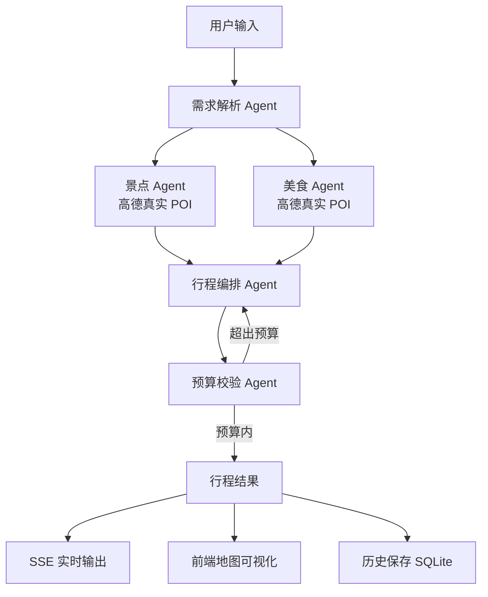

# AI 旅行规划助手

一个基于 **LangGraph + FastAPI + DeepSeek + 高德地图 + Vue 3** 的多智能体旅行规划应用。用户输入目的地、天数、预算和偏好后，系统通过多个 Agent 协作生成包含真实 POI、每日行程、美食推荐和预算审核的完整旅行方案，并支持实时进度、多轮调整和历史保存。

## 技术栈

| 层级 | 技术 | 用途 |
| --- | --- | --- |
| Agent 编排 | LangGraph | 多 Agent 状态管理、并行分支、条件路由 |
| 后端 | FastAPI | REST API、SSE 流式接口、SQLite 存储 |
| LLM | DeepSeek | 需求分析、行程编排、预算审核 |
| 地图数据 | 高德 Web 服务 API | 真实景点与美食 POI 检索 |
| 前端 | Vue 3 + TypeScript + Vite | 表单、进度、行程展示、高德地图可视化 |
| 地图渲染 | 高德 JS API 2.0 | 景点与美食地图标记 |
| 历史存储 | SQLite | 行程保存、查询、删除 |

## 系统架构



## 五个 Agent 职责

| Agent | 输入 | 输出 | 职责 |
| --- | --- | --- | --- |
| 需求解析 Agent | 用户请求 | 需求分析 + 搜索关键词 | 分析目的地、天数、预算、偏好，生成高德搜索词 |
| 景点 Agent | 需求分析 | 景点候选列表 | 调用高德 POI 搜索，返回真实景点及坐标 |
| 美食 Agent | 需求分析 | 美食候选列表 | 调用高德 POI 搜索，返回真实餐厅及坐标 |
| 行程编排 Agent | 候选景点 + 候选美食 | 每日行程 | 从真实候选清单中选择并编排每日行程 |
| 预算校验 Agent | 行程计划 | 预算报告 | 校验总花费，超支时自动触发重新编排 |

## 接口清单

| 方法 | 路径 | 说明 |
| --- | --- | --- |
| GET | `/health` | 健康检查 |
| POST | `/api/trip/plan` | 生成行程 |
| POST | `/api/trip/plan/stream` | SSE 流式生成行程，带 Agent 进度 |
| POST | `/api/trip/plan/adjust` | 基于当前行程执行多轮调整 |
| POST | `/api/history` | 保存行程 |
| GET | `/api/history` | 获取历史列表 |
| GET | `/api/history/{id}` | 获取历史行程详情 |
| DELETE | `/api/history/{id}` | 删除历史行程 |

## 项目结构

```text
ai-travel-planner/
├─ backend/
│  ├─ app/
│  │  ├─ agents/
│  │  │  ├─ requirement_agent.py   # 需求解析 Agent
│  │  │  ├─ attraction_agent.py    # 景点 Agent
│  │  │  ├─ food_agent.py          # 美食 Agent
│  │  │  ├─ itinerary_agent.py     # 行程编排 Agent
│  │  │  ├─ budget_agent.py        # 预算校验 Agent
│  │  │  ├─ graph.py               # LangGraph 工作流
│  │  │  └─ orchestrator.py        # 编排入口
│  │  ├─ schemas/
│  │  │  └─ trip.py                # Pydantic 数据模型
│  │  ├─ services/
│  │  │  ├─ deepseek_client.py     # DeepSeek 调用
│  │  │  ├─ prompt_builder.py      # 提示词构造
│  │  │  ├─ amap_client.py         # 高德 POI 检索
│  │  │  └─ history_service.py     # SQLite 历史存储
│  │  └─ main.py                   # FastAPI 入口
│  ├─ requirements.txt
│  └─ test_*.py                    # 各模块测试脚本
├─ frontend/
│  ├─ src/
│  │  └─ App.vue                   # 前端主页面
│  ├─ vite.config.ts
│  └─ package.json
├─ .gitignore
└─ README.md
```

## 本地运行

### 1. 后端

```powershell
cd backend
python -m venv venv
.\venv\Scripts\Activate.ps1
pip install -r requirements.txt
uvicorn app.main:app --reload
```

后端默认运行在 `http://127.0.0.1:8000`，Swagger 文档位于 `http://127.0.0.1:8000/docs`。

### 2. 前端

```powershell
cd frontend
npm install
npm run dev
```

前端默认运行在 `http://localhost:5173`。

## 环境变量

在项目根目录创建 `.env` 文件：

```env
DEEPSEEK_API_KEY=sk-你的DeepSeekKey
DEEPSEEK_BASE_URL=https://api.deepseek.com
DEEPSEEK_MODEL=deepseek-chat

AMAP_WEB_KEY=你的高德Web服务Key

VITE_AMAP_JS_KEY=你的高德JS API Key
VITE_AMAP_SECURITY_CODE=你的高德安全密钥
```

注意：

- `AMAP_WEB_KEY` 用于后端 POI 搜索，需在高德控制台申请“Web服务”类型 Key。
- `VITE_AMAP_JS_KEY` 用于前端地图，需申请“Web端(JS API)”类型 Key，并在域名白名单中加入 `localhost:5173`。
- `.env` 已被 `.gitignore` 忽略，不要提交到 Git。

## 当前功能

- [x] LangGraph 五 Agent 协作
- [x] SSE 实时 Agent 进度
- [x] 高德真实景点与美食 POI
- [x] 高德酒店 / 天气 / 周边游玩 / 驾车路线数据
- [x] 前端高德地图可视化
- [x] 按天切换路线并播放动画
- [x] 多轮对话调整行程
- [x] SQLite 历史保存与加载
- [x] 预算超支自动重排
- [x] 左侧对话 + 右侧行程一体化布局

## 可观测性与评测

每次行程生成都会记录 `trace_id`、LangGraph 节点耗时、LLM Token、外部 API 调用、缓存命中、质量/预算/路线结果和预估费用。

```powershell
# 指标汇总
curl http://127.0.0.1:8000/api/metrics/summary

# Prometheus 格式
curl http://127.0.0.1:8000/metrics

# 运行离线评测（默认串行，先跑 3 条冒烟）
cd backend
.\venv\Scripts\python.exe -m evaluation.run_eval --limit 3 --tag smoke-baseline
```

完整说明见 `docs/OBSERVABILITY.md`。

## 多用户与异步任务

账号体系使用 PBKDF2 加盐哈希 + 可吊销的 HS256 JWT；行程、对话、记忆和任务全部带 `user_id`，跨用户访问统一返回 404。生成流程提供异步任务接口，提交后立即返回 `task_id`，支持进度订阅、取消、单用户并发限制和提交限流。

```powershell
# 注册并拿到 token
curl -X POST http://127.0.0.1:8000/api/auth/register -H "Content-Type: application/json" -d "{\"email\":\"you@example.com\",\"password\":\"your-password\"}"

# 异步提交（202，返回 task_id）
curl -X POST http://127.0.0.1:8000/api/tasks/plan -H "Content-Type: application/json" -H "Authorization: Bearer <token>" -d "{\"request\":{\"destination\":\"成都\",\"days\":3,\"budget\":3000}}"

# 查询任务状态与结果
curl http://127.0.0.1:8000/api/tasks/<task_id> -H "Authorization: Bearer <token>"
```

默认 `REQUIRE_AUTH=false`，未登录请求落在公共演示账号，线上 Demo 打开即用；设为 `true` 后所有业务接口都要求登录。完整设计与 Redis 迁移路径见 `docs/MULTI_USER_TASKS.md`。


## 核心亮点

1. **LLM 与真实数据结合**
   需求分析 Agent 生成具体搜索词，高德 API 召回真实 POI，避免 LLM 编造不存在的景点和餐厅。

2. **LangGraph 条件路由**
   预算校验 Agent 检测超支后，自动将流程路由回行程编排 Agent 重新生成，最多重试 3 次。

3. **SSE 实时反馈**
   前端能实时看到“需求解析 -> 景点筛选 -> 美食筛选 -> 行程编排 -> 预算审核”的完整执行过程。

4. **可交互修正**
   生成行程后，用户可以用自然语言继续调整，例如“把第二天的餐厅换成更便宜的”，系统会保留不需要改动的部分。

5. **完整工程化闭环**
   包含数据模型、服务分层、测试脚本、历史存储、前端渲染与 Git 里程碑管理。


