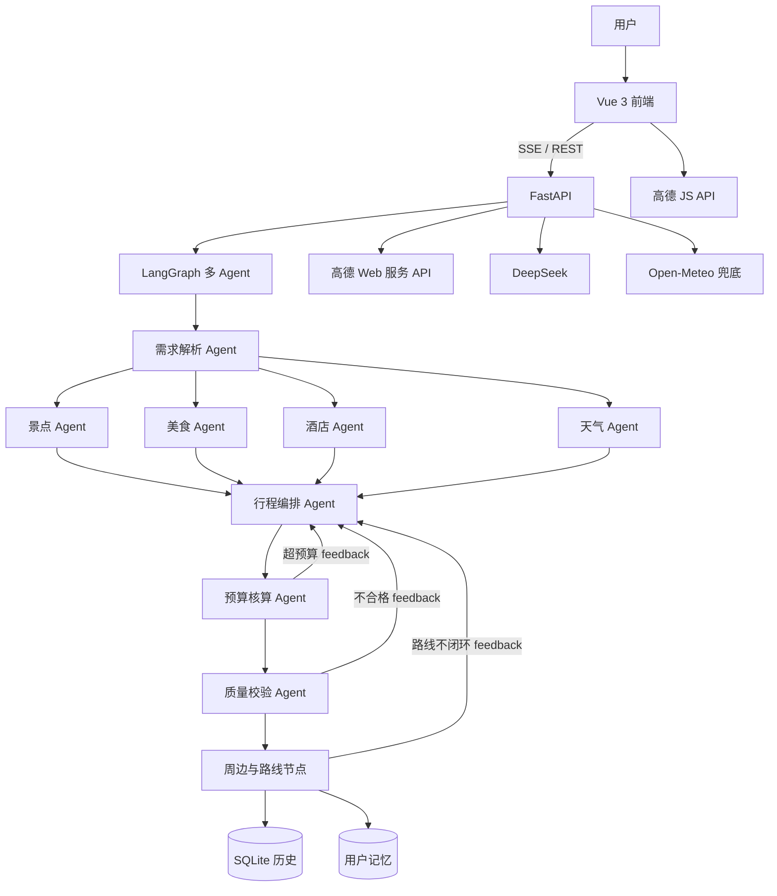
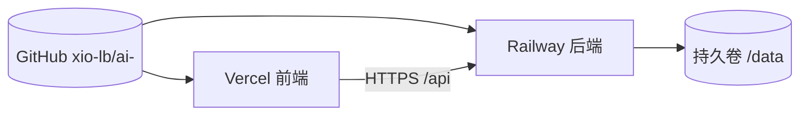

# AI 旅行规划助手 · 面试复习与项目讲解手册

> 本手册用于面试前系统复习，内容基于 `ai-travel-planner` 项目的真实实现。
> 阅读方式：先按“真实场景 → 设计思路 → 实现细节 → 难点复盘 → 面试问答”顺序过一遍，再使用文末速查表自测。

---

## 目录

1. 项目概述
2. 真实用户场景
3. 功能清单
4. 系统架构
5. 技术栈
6. 核心设计思路与原因
7. 后端实现细节
8. Agent 与工作流
9. 前端实现细节
10. 数据与存储
11. 测试与质量
12. 部署上线
13. 项目难点与前后对比
14. 面试高频问题与参考答案
15. 面试官视角补充问题
16. STAR 回答模板
17. 复习速查表
18. 已知不足与演进路线

---

## 1. 项目概述

**一句话介绍**：一个基于 LangGraph 多 Agent 协作的 AI 旅行规划助手，用户通过表单或自然语言对话描述需求，系统自动完成需求解析、真实 POI 搜索、行程编排、预算核算、路线闭环、地图可视化，并支持多方案对比、精准调整、记账反馈、历史保存与云部署。

**项目定位**：学习与演示型全栈 AI 产品，不做支付，不承诺实时票价与实时房态。

**产品价值**：普通 AI 聊天只会给“看起来合理的建议”，本项目交付的是“可执行、可查看、可调整、可复盘”的完整旅行方案。

---

## 2. 真实用户场景

1. 用户打开网站，在左侧表单填写目的地、天数、预算、偏好、出发城市、日期、节奏、酒店预算、饮食限制、人数。
2. 信息不全时，右侧 AI 对话窗口主动追问，每次最多问 1-2 个问题，直到需求完整。
3. 点击“生成行程”，前端通过 SSE 实时显示“正在解析需求 / 筛选景点 / 筛选美食 / 获取天气 / 编排每日行程”。
4. 系统从高德候选池中选择真实景点和餐厅，结合天气生成每日行程，并给出预算区间。
5. 用户在地图上按天查看路线，点击景点卡片可高亮对应标记，也可以自动/步行/驾车/公交/骑行切换路线。
6. 用户可播放路线动画，支持 1x / 2x / 4x 速度和停止。
7. 用户通过对话继续调整：“换一家火锅”“预算降到 5000”“加一天”，系统识别意图后精准修改。
8. 用户可一次生成“人文深度 / 美食探店 / 自然休闲”等多套主题方案并切换对比。
9. 用户可查看逐日逐类预算明细，旅行中填写实际花费，系统对比“预计区间 vs 实际总花费”。
10. 用户可导出 Markdown / 浏览器打印 PDF / 分享图，并保存行程到历史记录。
11. 系统保存用户偏好与去过城市，下次生成自动带入记忆。

---

## 3. 功能清单

| 模块 | 功能 |
| --- | --- |
| 需求收集 | 完整表单 + 对话式补全 + 记忆带入 |
| 行程生成 | 多 Agent 协作 + SSE 实时进度 |
| 数据来源 | 高德真实 POI / 路线 / 天气，Open-Meteo 天气兜底 |
| 多方案 | 一次生成 3 套主题方案，可切换 |
| 精准调整 | 换餐厅 / 降预算 / 加天 / 减天 / 改节奏 / 换酒店 / 换交通 |
| 地图 | 高德 JS API，景点标记、路线绘制、列表联动 |
| 播放 | 路线动画播放、速度调节、停止 |
| 预算 | 预计区间（min/max/typical）+ 逐日逐类明细 |
| 记账 | 实际花费填写、快捷类别、自定义类别、保存历史、预计 vs 实际 |
| 记忆 | 偏好 / 去过城市 / 饮食 / 节奏 / 交通 / 酒店预算 / 人数 |
| 质量 | 候选池校验、坐标校验、天数校验、路线闭环校验、有界重试 |
| 票务 | 热门景点公众号入口，其余携程搜索兜底 |
| 历史 | SQLite 保存 / 列表 / 详情 / 删除 / 旧数据迁移 |
| 导出 | Markdown / 浏览器打印 / 分享图 |
| 部署 | GitHub + Vercel 前端 + Railway 后端，推送自动部署 |

---

## 4. 系统架构



**部署架构**



---

## 5. 技术栈

| 层级 | 技术 | 用途 |
| --- | --- | --- |
| 前端 | Vue 3 + TypeScript + Vite | 表单、聊天、地图、行程展示 |
| 地图 | 高德 JS API 2.0 | 标记、路线、动画播放 |
| 后端 | FastAPI + Uvicorn | REST API、SSE 流式接口 |
| Agent | LangGraph | 状态图、并行分支、条件重试 |
| LLM | DeepSeek | 需求解析、行程编排、预算审核、对话 |
| 数据 | 高德 Web 服务 API | POI、路线、天气、周边 |
| 缓存 | SQLite | 高德结果持久化缓存 |
| 存储 | SQLite | 历史行程、用户记忆 |
| 测试 | pytest + Playwright | 后端单元测试、前端冒烟测试 |
| 部署 | Docker Compose | 自托管方案 |
| 云部署 | Vercel + Railway | 前端静态托管 + 后端 Docker |
---

## 6. 核心设计思路与原因

### 6.1 为什么用 LangGraph 多 Agent

旅行规划是一个“数据依赖明确、阶段可拆分、结果需要校验”的复杂任务：

- 需求解析后才能确定搜索关键词；
- 景点、美食、酒店、天气互不依赖，可以并行；
- 行程编排依赖全部候选数据；
- 预算和质量需要校验，失败要带原因重试。

如果用“一个巨大的 Prompt”一次生成，问题包括：结果不可控、无法看到中间进度、错误无法定位、重试成本高。LangGraph 用状态图把这些阶段显式建模，让流程可观察、可测试、可终止。

### 6.2 为什么 Agent 之间用共享状态而不是互相发消息

核心文件：`backend/app/agents/graph.py`。

`AgentState` 是 TypedDict，所有 Agent 读写同一份状态。每个节点只返回自己负责的字段增量，由 LangGraph 合并：

- 景点节点只写 `attractions`
- 美食节点只写 `foods`
- 天气节点只写 `weather`
- 行程节点写 `plan`

这样设计的好处：

1. 通信协议就是数据结构，不是不可控的自然语言；
2. 节点之间不互相依赖，替换单个 Agent 不影响其他节点；
3. 状态可序列化、可调试、可保存快照；
4. 避免“LLM 对 LLM 聊天”造成的语义漂移和成本爆炸。

### 6.3 为什么用“候选池约束”而不是让 LLM 自由生成

景点和餐厅由高德 POI 搜索先生成候选列表，行程编排 Agent 只能从候选池中选择。原因：

1. 高德返回的是真实名称、地址、坐标，LLM 不负责“创造事实”；
2. 即使 LLM 改写了景点名称，质量校验也能用名称归一化找回候选并修复坐标；
3. 从源头降低“幻觉叠加”：需求 Agent 只生成关键词，搜索 Agent 只负责检索，编排 Agent 只负责选择与排序。

### 6.4 为什么预算给“区间”而不是具体数字

酒店价格随节假日浮动、每个人饭量不同、交通方式可能临时改变，所以硬编码具体金额没有意义。设计上：

- AI 输出 `min / max / typical` 弹性区间；
- 前端按天、按类别展示区间；
- 旅行后用户填写实际花费，形成“预计 vs 实际”对比；
- 历史实际花费可反哺用户记忆，为后续个性化预算做数据准备。

### 6.5 为什么用 SSE 而不是轮询或 WebSocket

生成行程是 30 秒级的长任务，且过程天然是“服务端主动推送”：

- SSE 基于 HTTP，部署简单，兼容反向代理；
- 通过 `queue.Queue + threading.Thread`，生成在后台线程跑，主线程持续向客户端输出事件；
- 事件类型包括 `progress / node / variant-start / variant-done / done / error / exit`；
- 前端用 `fetch + ReadableStream` 逐段解析，断线可提示重试。

### 6.6 为什么 SQLite

项目是单用户演示 + 低并发场景：

- 零运维、单文件、容易备份；
- 历史行程是整份 JSON，SQLite 足够；
- 高德缓存同样用 SQLite，避免重复请求；
- 后续升级多用户/高并发时，可平滑迁移到 Postgres，接口层已经通过 service 隔离。

### 6.7 为什么做“有界重试”

预算、质量、路线校验都可能失败，但不能无限重试：

- 每次重试都携带 `feedback`，告诉行程 Agent 具体失败原因；
- `retry_count` 上限 3 次，保证流程必然终止；
- 超过上限后保留 `quality_report` 的 warning，前端展示“带警告交付”，而不是崩溃。

### 6.8 为什么 Vercel + Railway 前后端分离

- Vercel 擅长静态前端，不适合跑 FastAPI 长连接和 SSE；
- Railway 提供 Docker + 持久卷，适合 Python 后端；
- 两个平台都支持 GitHub 自动部署，推 `main` 即上线；
- 前端通过 `VITE_API_BASE` 指向后端，CORS 已配置。

### 6.9 为什么“精准调整”优先于整段重生成

用户说“换一家餐厅”，如果整段重生成，会丢掉用户已满意的部分，且慢、贵、不可预期。设计上：

1. 先用意图分类 Agent 识别 `change_food / lower_budget / add_day / remove_day / change_pace / change_hotel / change_transport / general`；
2. 能精准处理就走专用 handler，只改相关字段；
3. 无法归类才重新走整张图，并把用户指令作为 `instruction` 传入。

### 6.10 为什么记录“用户记忆”

同一个用户第二次规划时，如果还问“几个人、什么口味、去过哪”，体验很差。设计上：

- 保存行程时自动更新偏好、去过城市、饮食、节奏、交通、酒店预算、人数；
- 下次生成前把记忆合并进请求；
- 对话 Agent 也会复用已知记忆，避免重复提问；
- 这是后续个性化推荐的数据基础。
---

## 7. 后端实现细节

### 7.1 接口清单

| 方法 | 路径 | 说明 |
| --- | --- | --- |
| GET | `/health` | 健康检查 |
| POST | `/api/chat` | 对话式需求收集，返回 reply / ready / trip_request |
| POST | `/api/trip/plan` | 同步生成行程 |
| POST | `/api/trip/plan/stream` | SSE 流式生成行程 |
| POST | `/api/trip/plan/variants` | 同步生成多套主题方案 |
| POST | `/api/trip/plan/variants/stream` | SSE 流式生成多套主题方案 |
| POST | `/api/trip/plan/adjust` | 意图识别 + 精准调整或整图重生成 |
| POST | `/api/trip/plan/routes` | 按交通模式重算路线 |
| POST | `/api/history` | 保存行程并更新记忆 |
| GET | `/api/history` | 历史列表 |
| GET | `/api/history/{id}` | 历史详情（自动迁移旧数据） |
| DELETE | `/api/history/{id}` | 删除历史 |
| GET | `/api/memory` | 获取用户记忆 |
| PUT | `/api/memory` | 更新用户记忆 |

### 7.2 SSE 事件协议

```
event: progress
data: {"message": "正在搜索：宽窄巷子、武侯祠…"}

event: node
data: {"node": "itinerary"}

event: variant-start
data: {"index": 0, "label": "人文深度", "total": 3}

event: variant-done
data: {plan}

event: done
data: {plan}

event: error
data: {"message": "AI 服务暂时不可用，请稍后重试"}

event: exit
```

### 7.3 错误处理

- FastAPI 统一异常处理，把 Pydantic 校验错误、HTTPException、未知异常统一转为中文提示；
- 对外部 API 失败做了分级：高德失败切缓存/兜底，天气失败返回空对象，路线失败返回空 legs；
- 前端收到 error 事件后展示错误，并保留表单内容，支持重试。

---

## 8. Agent 与工作流

### 8.1 AgentState

```python
class AgentState(TypedDict):
    request: TripRequest
    requirement: dict
    attractions: list[AttractionCandidate]
    foods: list[FoodCandidate]
    hotels: list[HotelCandidate]
    weather: WeatherInfo | None
    plan: TripPlan | None
    feedback: str | None
    retry_count: int
    instruction: str | None
    current_plan: TripPlan | None
    nearby: list[NearbyPoi]
    routes: dict[str, RouteInfo]
```

### 8.2 节点职责

| 节点 | 输入 | 输出 | 失败处理 |
| --- | --- | --- | --- |
| analyze | request | requirement 关键词 | LLM 解析失败直接报错 |
| attractions | requirement | attractions 候选 | 高德失败返回空候选 |
| foods | requirement | foods 候选 | 高德失败返回空候选 |
| hotels | request | hotels 候选 | 高德失败返回空候选 |
| weather | destination/date | weather | 高德失败用 Open-Meteo / 空对象 |
| itinerary | 候选 + 天气 + feedback | plan | LLM 输出校验失败重试 |
| budget | plan | budget_report | 超预算写 feedback 回 itinerary |
| quality | plan + 候选 | quality_report | 不通过写 feedback 回 itinerary |
| surrounding | plan + hotel | nearby + routes | 高德失败返回空，路线不闭环写 feedback |

### 8.3 工作流图

```text
START
  └─ analyze
       ├─ attractions ─┐
       ├─ foods      ─┤
       ├─ hotels     ─┼─ itinerary ─ budget ─ quality ─ surrounding ─ END
       └─ weather    ─┘

budget 超预算 ──────────────> itinerary（feedback）
quality 不通过 ─────────────> itinerary（feedback）
surrounding 路线不闭环 ──────> itinerary（feedback）
所有重试 retry_count < 3
```

### 8.4 多方案生成

- `pick_variant_themes` 根据偏好选择主题：默认人文 / 美食 / 自然；
- 检测亲子关键词替换为亲子，检测经济关键词替换为经济；
- 每个主题通过修改 `pace / preferences / variant_theme` 重新跑一次完整图；
- 前端通过 `variant-start / variant-done` 实时显示“正在生成第 n/3 套”。

### 8.5 精准调整

- `classify_adjust_intent` 让 LLM 输出意图 + 目标天 + 目标名 + 关键词 + 新预算；
- handler 全部基于 `plan.model_copy(deep=True)`，避免污染原计划；
- `change_food` 只重搜美食并替换目标天；
- `lower_budget` 只改预算并触发平价餐厅替换；
- `add_day / remove_day` 只增删天并重排天号、重算总价；
- 只有 `general` 才走整图重生成。

---

## 9. 前端实现细节

### 9.1 页面结构

- 左侧：基础信息表单 + 历史记录 + 用户记忆面板
- 中间：行程主画布（每日行程、酒店、天气、地图、预算、记账、导出）
- 右侧：AI 对话窗口
- 主题：旅行杂志 / 沉浸感风格，轮换大图画布，动效交互

### 9.2 地图与路线

- 动态加载高德 JS API，配置 `VITE_AMAP_JS_KEY` 与安全密钥；
- `renderMap` 绘制景点标记、InfoWindow、Polyline；
- 点击景点卡片 `focusSpot` 高亮对应标记；
- `playRoutes` 用插值点 + 定时器播放路线动画，支持 1x / 2x / 4x 和停止；
- 切换交通模式调用 `/api/trip/plan/routes` 重算。

### 9.3 记账

- 初始化为逐日逐类的空记录；
- 支持基础类别（门票/餐饮/住宿/交通）和快捷自定义类别（纪念品/特产/小吃/拍照/演出/其他）；
- 支持任意自定义类别、删除行；
- 保存时同步到 `plan.budget_detail.actual_expenses` 并写入历史；
- 顶部对比“总预算 / 预计区间 / 实际总花费”，自动提示低于 / 超出 / 区间内。

### 9.4 导出

- Markdown：生成可复制的行程文档，包含实际花费；
- PDF：`window.print()` 浏览器打印；
- 分享图：`html-to-image` 截取分享卡片为 PNG。

---

## 10. 数据与存储

### 10.1 历史行程

- `trip_history` 表，`plan_json` 保存完整 TripPlan；
- 保存时先更新用户记忆，再写历史；
- 读取时自动执行 `migrate_plan`，补齐酒店、路线、notes、transport_mode 等旧字段。

### 10.2 用户记忆

- `user_memory` 单行表（当前单用户设计）；
- 字段：偏好、去过城市、饮食、节奏、交通、酒店预算、人数、更新时间；
- 保存行程时合并更新，生成请求时自动合并进 request。

### 10.3 高德缓存

- `amap_cache` 表，namespace + cache_key 主键；
- 覆盖城市中心、POI、路线、天气；
- TTL：POI 7 天、路线 1 天、天气 30 分钟、城市中心 30 天；
- 内存二级缓存 + SQLite 持久化，进程重启不丢。

---

## 11. 测试与质量

| 类型 | 工具 | 内容 |
| --- | --- | --- |
| 后端单测 | pytest | 26 个用例：schemas / 缓存 / 历史 / 记忆 / 错误处理 / 质量校验 / 降级 |
| 前端冒烟 | Playwright | 1 个用例：主页核心控件可加载 |
| 构建 | vue-tsc + vite | 类型检查 + 生产构建，约 4 秒 |
| 质量校验 | quality_agent | 候选池、坐标、天数、景点数、路线闭环 |

当前还没有 GitHub Actions CI，这是明确的下一个工程项。
---

## 12. 部署上线

### 12.1 仓库与平台

- GitHub：`xio-lb/ai-`，私有仓库，默认分支 `main`
- Vercel：前端 `ai-travel-planner`，Root Directory `frontend`，Framework Vite
- Railway：后端 `ai-travel-planner`，根目录 Dockerfile，持久卷挂载 `/data`
- 推送流程：本地 `git push origin main` → Vercel 自动构建前端 + Railway 自动构建后端

### 12.2 环境变量

Vercel（前端构建期）：

- `VITE_AMAP_JS_KEY`
- `VITE_AMAP_SECURITY_CODE`
- `VITE_API_BASE`：`https://ai-travel-planner-production-3d31.up.railway.app`

Railway（后端）：

- `DEEPSEEK_API_KEY`
- `DEEPSEEK_BASE_URL`
- `DEEPSEEK_MODEL`
- `AMAP_WEB_KEY`
- `HISTORY_DB_PATH=/data/trip_history.db`
- `AMAP_CACHE_DB_PATH=/data/amap_cache.db`

### 12.3 域名与备案

- Vercel 自带 `*.vercel.app` 域名，海外可访问；
- 国内域名未备案也可以绑定 Vercel / Railway，因为服务器在海外，不需要 ICP；
- 只有把服务放到中国大陆服务器或使用大陆 CDN 时才需要 ICP 备案；
- 注意：`vercel.app` 在国内网络可能被墙，当前机器已验证无法直连，这是网络问题，不是部署失败。

### 12.4 Docker 自托管

```bash
cp .env.example .env
# 编辑 .env 填入真实密钥
docker compose up -d --build
```

访问 `http://服务器IP`，健康检查 `http://服务器IP/health`。

---

## 13. 项目难点与前后对比

面试时讲难点建议用 STAR：背景 → 任务 → 行动 → 结果，并且只讲“代码/测试能验证的数字”，不编造用户增长类数据。

### 难点 1：SSE 生成流程卡在天气节点

- 背景：行程生成依赖高德天气接口，接口异常时无超时、无兜底，SSE 一直停在“正在获取天气”。
- 方案：天气节点失败降级、Open-Meteo 兜底、高德缓存、接口超时控制；进度事件可定位卡点。
- 修改前：天气接口异常时该次生成 100% 卡死，用户只能刷新。
- 修改后：天气失败自动降级，行程仍可生成；后端 26 个 pytest 全部通过，前端冒烟测试通过。

### 难点 2：路线不是闭环

- 背景：播放路线时只有“酒店→单个景点”，缺少景点间路线和最后回酒店的路线；不同交通方式路线不同。
- 方案：以酒店为起点和终点，用高德 Route API 生成完整闭环；支持 auto / walking / driving / transit / bicycling；质量校验增加闭环检查。
- 修改前：N 个景点生成 N 条碎片路线，路线不闭合。
- 修改后：生成“酒店→景点1→…→景点N→酒店”共 N+1 段，路线闭合，切换交通方式会重算。

### 难点 3：pytest 无法统一运行

- 背景：后端根目录散落旧 `test_*.py`，与 `backend/tests/` 同名冲突，pytest 收集阶段直接报错。
- 方案：整理成 `backend/tests` 包，增加 `__init__.py` 和 `conftest.py`，统一 pytest 配置。
- 修改前：pytest 收集 1 error，无法运行。
- 修改后：26 个用例全部通过。

### 难点 4：记账功能不完整

- 背景：记账没有保存、金额不更新、类别太少，漏掉纪念品/特产/小吃/拍照等真实支出。
- 方案：增加保存与历史同步、预计 vs 实际对比、快捷自定义类别、任意自定义项目。
- 修改前：只有 4 类基础支出，实际金额无法持久化。
- 修改后：4 类基础 + 6 类快捷自定义（纪念品/特产/小吃/拍照/演出/其他），支持任意自定义，保存进历史。

### 难点 5：调整需求容易整段重生成

- 背景：用户“换一家餐厅”会触发整段重新生成，慢且丢失已满意安排。
- 方案：意图分类 + 8 类专用 handler，只有 general 才整图重生成。
- 修改前：“换餐厅”和“重做整份行程”成本相同。
- 修改后：8 类意图走精准路径，general 才全量重跑。

### 难点 6：前端单文件过大

- 背景：`App.vue` 超过 1600 行，生成、聊天、地图、记账、历史都在一个文件。
- 现状：功能完整但维护成本高。
- 演进：按领域拆成 ChatPanel / PlanTimeline / RouteMap / BudgetLedger / HistoryDrawer，引入统一状态层。
---

## 14. 面试高频问题与参考答案

### 14.1 介绍一下这个项目

> 这是一个 AI 旅行规划助手。用户通过表单或对话描述需求，后端用 LangGraph 编排多个 Agent：需求解析、景点搜索、美食搜索、酒店搜索、天气、行程编排、预算核算、质量校验、周边路线。系统从高德拉取真实 POI，行程 Agent 只能从候选池选择，预算超支或质量不过会自动带原因重试。前端用 Vue 3 展示每日行程、地图路线动画、多方案对比、记账、历史、导出。最后通过 GitHub 推送到 Vercel 和 Railway 自动部署。整个项目从产品交互到多 Agent 编排再到云部署都是我独立完成的。

### 14.2 为什么用多 Agent？一个 Prompt 不行吗？

> 旅行规划有明确的数据依赖：先解析需求，再并行搜索，最后编排和校验。单 Prompt 的问题是不可控、不能显示中间进度、错误无法定位、重试成本高。多 Agent 让每个节点职责单一、可单独测试、可并行、可降级。本质是把不可预测的 LLM 调用变成可预测的工作流。

### 14.3 Agent 之间如何通信与协调？

> 用 LangGraph 的共享状态，不互相发消息。`AgentState` 是 TypedDict，节点只返回自己的字段增量，由编排层合并。流程控制在图里：数据采集并行、行程编排汇合、预算和质量用条件边触发带 feedback 的重试。好处是通信协议是数据结构，节点解耦，状态可调试可快照。

### 14.4 如何实现任务分解与规划？

> 分四层：需求 Agent 把模糊需求拆成搜索关键词；图结构把任务拆成可并行的数据采集和必须汇合的编排；每个 Agent 只负责一个领域；预算/质量/路线校验失败时带着原因做有界再规划。对于开放任务，我会加 Planner-Executor，但领域明确时静态工作流更可控。

### 14.5 如何解决“幻觉叠加”？

> 三层防护。生成层：LLM 只能从高德候选池选择，不创造景点和坐标；事实数据来自 API，LLM 只做选择和编排。校验层：Pydantic schema 校验每个 Agent 输出，质量 Agent 检查候选池归属、坐标、天数、闭环。恢复层：失败带原因重试，最多 3 次，连续失败就带 warning 交付。未知信息不编，明确标注“待确认”。

### 14.6 如何解决“协调失效”？

> 用显式状态机保证流程收敛：共享状态 + 类型契约避免写冲突；编排层集中控制先后和并行；重试有上限且带原因；外部 API 失败降级而不是整体崩溃；SSE 和日志保证可观测。再进一步会加收敛检测、超时熔断、图级集成测试。

### 14.7 如何保证状态一致性？

> 三层：状态层用单一共享状态，节点只返回增量，避免互相覆盖；数据层用 SQLite 事务，保存行程和更新记忆要么都成功要么都回滚；执行层每个节点边界做完整校验，失败走有界重试。升级到生产会加不可变快照、乐观锁、request_id 幂等、事件流重建。

### 14.8 如何评估多 Agent 系统效果？

> 分四层：单 Agent 用 golden dataset 看准确率/召回率/偏差率；链路层看端到端成功率、幻觉率、重试收敛率、状态完整性；产品层看采纳率、修改率、预计 vs 实际偏差、导出行为；成本层看单次 Token、延迟、缓存命中率、无效重试成本。离线用固定数据源保证可复现，线上用 trace + 用户行为做 A/B。

### 14.9 遇到的最大难点是什么？

> 技术上是 SSE 生成流程卡在天气节点：外部接口异常导致整单失败。我加了超时、Open-Meteo 兜底、缓存和节点降级，并用测试锁定。产品上是路线闭环：之前只有酒店到景点的碎片，我改成以酒店为起终点的完整闭环，并让交通模式切换触发重算。这两个问题都让我更理解“AI 系统不是模型聪明就够，还要有失败边界和可观测性”。

### 14.10 项目的核心数据流是怎样的？

> 表单/对话 → TripRequest → 记忆合并 → 需求解析出关键词 → 并行搜索高德候选 → 天气 → 行程编排 → 预算核算 → 质量校验 → 周边与路线 → TripPlan → 前端地图/详情/记账/导出 → 保存历史并更新记忆。全程 SSE 上报节点进度。

### 14.11 为什么选 DeepSeek？

> 项目定位国内场景，DeepSeek 中文效果好、成本低、支持 JSON 输出，和 OpenAI SDK 兼容，接入成本小。模型通过 `DEEPSEEK_MODEL` 环境变量可替换，未来可以切 GPT 或开源模型。

### 14.12 为什么用高德而不是其他地图？

> 高德在国内 POI、路线、天气、周边数据覆盖最完整，Web 服务 API 和 JS API 配合成熟，适合国内旅行场景。真实坐标、真实路线是项目可信度的基础。
### 14.13 SSE 流式生成是怎么实现的？

> 前端 POST 请求后，后端创建 `queue.Queue`，启动后台线程跑 LangGraph，线程把节点进度和结果写入队列；主线程用 `StreamingResponse` 持续从队列取事件，以 `event: xxx\ndata: xxx\n\n` 格式推给前端。前端用 `fetch + ReadableStream` 逐段解析文本，按事件类型更新进度或接收行程。好处是长任务不阻塞 HTTP，断线后可以提示重试。

### 14.14 路线闭环怎么保证？

> 行程生成后，surrounding 节点取第一个酒店作为起点和终点，按每日景点顺序调用高德 Route API 生成 legs，最后一段一定是“最后一个景点 → 酒店”。质量校验检查 route_legs 是否存在以及首尾是否闭合，不通过就带 feedback 回到 itinerary 重排，最多 3 次。

### 14.15 天气数据怎么保证可用？

> 主数据源是高德天气，失败时用 Open-Meteo 7 天预报兜底；两类数据都做缓存，高德天气缓存 30 分钟。天气 Agent 内部每个调用都 try/except，最终至少返回一个带 travel_date 的 WeatherInfo，绝不阻塞整个图。

### 14.16 预算不准确怎么办？

> 产品设计上不承诺“准确”，而是给区间和反馈闭环。AI 输出 min/max/typical，前端按天按类展示；用户旅行后记账，系统保存实际花费并和预计对比。后续可以把实际花费写入用户记忆，逐步个性化。如果要更准，需要接酒店日历价、门票接口和真实交通价格，这是商业数据源的范畴。

### 14.17 用户记忆当前是全局的，怎么解释？

> 当前是单用户演示版，记忆表是固定 id=1。架构上记忆已经独立成 service，未来加 user_id 字段和登录态就能多用户隔离。我不会说已经支持多用户，而是说明这是明确的演进方向。

### 14.18 购票跳转为什么是搜索链接？

> 官方 deep link 和票务库存需要第三方商业 API，演示版做不到。我实现的是“最接近官方入口”的方案：热门景点优先跳公众号搜索页，其他景点跳携程门票搜索页兜底，保证用户至少能找到正确渠道。正式版需要接官方小程序或票务 API。

### 14.19 前端为什么是一个大文件？

> 为了快速完成端到端 Demo，我选择单体文件保证迭代速度。缺点是维护成本高。演进方向是按领域拆组件：ChatPanel、PlanTimeline、RouteMap、BudgetLedger、HistoryDrawer，再引入统一状态层管理 SSE 和行程状态。

### 14.20 测试能证明什么？

> 后端 26 个 pytest 覆盖 schema、缓存、历史、记忆、错误处理、质量校验、降级；前端 Playwright 验证主页核心控件。它们保证核心业务逻辑可以回归。当前缺 CI 和真实 API 集成测试，这是下一个工程项。

### 14.21 PDF 导出是真实 PDF 吗？

> 当前用浏览器打印 `window.print()`，分享图用 `html-to-image`，是演示级实现。正式版会换服务端模板渲染或分页打印模板，解决分页、字体、长行程格式问题。

### 14.22 安全上做了哪些事？

> 后端密钥只在服务端环境变量；前端只暴露高德 JS Key，并配置安全密钥。CORS 当前放开是为了跨平台部署。生产级还需要：登录认证、限流、输入长度限制、prompt 注入防护、JS Key 域名白名单。

### 14.23 为什么 Vercel 放前端，Railway 放后端？

> Vercel 对静态站点和构建体验最好，但不适合 FastAPI 的 SSE 长连接。Railway 能跑 Docker、挂持久卷，适合 Python 服务。两个平台都接 GitHub，推 main 自动部署。前端通过 `VITE_API_BASE` 指向后端域名。

### 14.24 如何控制成本和延迟？

> 三条：高德结果做 SQLite 缓存，减少重复外部请求；意图精准调整避免整图重跑；多方案生成串行执行，前端显示“第 n/3 套”。再进一步会加：LLM 调用次数统计、超时熔断、缓存命中率监控、低峰预生成。

### 14.25 如果重做这个项目，架构上会改什么？

> 前端拆组件并引入状态管理；后端把 `App.vue` 的逻辑按领域服务化；数据库换 Postgres，历史/记忆/缓存分表；加用户认证和 request_id；接入 LangSmith/Langfuse 做 trace；加 CI 自动测试；质量校验接入营业时间和真实票价；票务接官方 deep link。核心 Agent 编排方式不变，因为它已经被验证可行。

### 14.26 如何防 Prompt Injection？

> 当前聊天内容会进入 LLM prompt，确实有注入风险。防御方向：系统提示词加边界声明；用户输入与结构化数据分离；对输出做 schema 校验；不允许模型执行工具/代码；关键指令用程序逻辑而不是让模型自己决定；输入长度限制；必要时加内容过滤和二次确认。

### 14.27 如何保证服务可用性？

> 外部依赖全部有超时和降级：高德失败用缓存/备用源，天气失败返回空，路线失败不阻塞；SSE 线程 daemon 化避免拖死进程；后端统一异常处理返回中文错误；前端支持重试。生产级还需要健康检查、日志告警、限流、多副本。

### 14.28 移动端适配做了吗？

> 当前路线图中 5.6 移动端验证还未完成，属于已知缺口。如果被问到，回答：桌面端是主场景，移动端布局已做响应式基础，但 375/390/768/1024/1440 五档验证和窄屏交互测试还没有全部完成，这是上线前必须补的一项。

### 14.29 为什么选择 SQLite 而不是 MySQL？

> 当前单用户、低并发、单实例部署，SQLite 零运维、单文件、易备份，足够支撑。历史行程和缓存都是 JSON 结构，SQLite 很合适。如果多用户上线，会换 Postgres：历史、记忆、缓存分表，接口层已经隔离，迁移成本可控。

### 14.30 你最满意的设计是什么？

> 候选池约束 + 有界反馈重试。它解决了 AI 系统最常见的两个问题：LLM 编造事实，以及失败后无限重试。候选池让“事实”来自高德，重试带 feedback 让“纠正”来自校验器，而不是靠运气。这个设计可以复用到很多 Agent 系统。
---

## 15. 面试官视角补充问题

以下是面试官大概率会追问的高频题，回答要点一并给出：

| 问题 | 回答要点 |
| --- | --- |
| 为什么不用现成的携程/马蜂窝？ | 它们解决“预订”，我解决“规划+个性化”，重点是 AI 工作流和反馈闭环 |
| 如果用户需求自相矛盾怎么办？ | 需求解析输出结构化字段，冲突字段以用户最近一次表达为准；记忆只做辅助，不做硬覆盖 |
| 如果高德某城市没有 POI 怎么办？ | 返回空候选，质量校验报告缺失，前端提示“该城市数据不足”，不硬编 |
| 如果 DeepSeek 返回的不是 JSON 怎么办？ | `chat_json` 解析失败会抛错，由调用方重试或走降级；Pydantic 再兜一层 |
| 多方案之间如何保证真的不同？ | 每个主题修改 pace、preferences、variant_theme，重新走完整图，不是只改标题 |
| 用户记忆会不会越记越乱？ | 当前是合并追加去重；正式版需要按时间衰减、按用户隔离、支持删除 |
| 缓存会不会导致数据过期？ | 每个 namespace 有 TTL：POI 7 天、路线 1 天、天气 30 分钟、城市中心 30 天 |
| 如何排查一次生成失败？ | 看 SSE 停在哪个 node，看后端日志异常，看质量报告 issues，看重试次数 |
| 如何演示项目？ | 准备“成都 3 天美食游”：对话补全 → 生成 → 多方案 → 切换交通 → 播放路线 → 记账 → 导出 |
| 如果让你加一个功能，加什么？ | 最优先：用户登录隔离 + 移动端验证；其次：CI、真实票价、票务 deep link |
| 你如何证明代码是你写的？ | 能讲清每个模块的取舍、踩过的坑、修复前后的测试结果，而不是背概念 |
| 项目有没有商业价值？ | 定位是 AI 产品能力演示，不做支付承诺；商业化的第一步是用户系统和真实数据源 |

---

## 16. STAR 回答模板

面试官问“讲一个项目难点”时，按这个结构：

**S（背景）**：行程生成依赖高德天气，外部接口异常时没有兜底，SSE 一直卡在天气节点，用户只能刷新。

**T（任务）**：让外部数据失败不拖垮整个生成流程，同时保留进度可观测。

**A（行动）**：给天气 Agent 加 try/except 降级；主源高德失败切 Open-Meteo；加 SQLite 缓存和 30 分钟 TTL；SSE 增加节点事件，前端能显示“正在获取天气”并知道卡点；补测试锁定回归。

**R（结果）**：天气接口失败不再阻塞行程；后端 26 个 pytest 通过；前端冒烟测试通过；部署后 `/health` 正常。

**加分收尾**：这个经历让我明白，AI 系统的可靠性不取决于模型多聪明，而取决于每个外部依赖都有失败边界。

---

## 17. 复习速查表

### 项目一句话

> LangGraph 多 Agent + FastAPI + DeepSeek + 高德 + Vue3 的 AI 旅行规划助手。

### 核心数字

- 后端 pytest：26 passed
- 前端 Playwright：1 passed
- 生产构建：约 4 秒
- Agent 节点：9 个（analyze / attractions / foods / hotels / weather / itinerary / budget / quality / surrounding）
- 精准调整意图：8 类
- 多方案主题：默认 3 套
- 重试上限：3 次
- 记账类别：4 基础 + 6 快捷自定义
- 部署：GitHub + Vercel + Railway，推 main 自动部署

### 一句话回答模板

- 架构：`表单/对话 → 需求解析 → 并行搜索 → 编排 → 预算/质量校验 → 路线 → 前端`
- 防幻觉：`候选池约束 + 外部 API 事实 + schema 校验 + 质量闸门 + 有界重试`
- 状态一致：`共享状态 + 增量写入 + 事务 + 节点边界校验`
- 评估：`单 Agent 指标 → 链路指标 → 产品指标 → 成本指标`
- 部署：`GitHub push → Vercel 前端 + Railway 后端自动构建`

---

## 18. 已知不足与演进路线

### 当前已知不足

1. 无用户登录，记忆和历史全局共享；
2. 无 CI，推送代码不会自动跑测试；
3. `App.vue` 单文件过大，维护成本高；
4. 导出 PDF 是浏览器打印，不是真正 PDF 文件；
5. 购票是搜索链接，不是官方 deep link；
6. 预算为估算区间，未接真实价格源；
7. 天气只在生成时获取，不自动跟踪变化；
8. 移动端验证未完成；
9. 无限流、无 prompt 注入防护；
10. SQLite 单实例，无自动备份；
11. 国内访问 Vercel 不稳定；
12. 高德 JS Key 暴露在前端，需要域名白名单。

### 演进优先级

| 优先级 | 方向 | 说明 |
| --- | --- | --- |
| P0 | 移动端验证 | 375/390/768/1024/1440 五档，无横向滚动 |
| P0 | CI | GitHub Actions：pytest + lint + build + smoke |
| P1 | 用户系统 | user_id 隔离历史与记忆，登录态 |
| P1 | 前端组件化 | 拆分 ChatPanel / PlanTimeline / RouteMap / BudgetLedger / HistoryDrawer |
| P1 | 数据库升级 | SQLite → Postgres，历史/记忆/缓存分表 |
| P2 | 真实数据源 | 营业时间、门票、酒店日历价、官方票务 deep link |
| P2 | 可观测性 | LangSmith/Langfuse trace、失败率、Token 成本监控 |
| P2 | 国内访问 | 自定义域名 + 国内 CDN，或香港/新加坡服务器 |

---

## 结束语

这份手册的价值不是“背答案”，而是让你能把项目讲成一个完整故事：用户遇到什么问题 → 我为什么这样设计 → 代码怎么落地 → 踩过什么坑 → 下一步怎么演进。面试官最认可的，是你对每个设计都能说出取舍，而不是只会说“功能都有”。